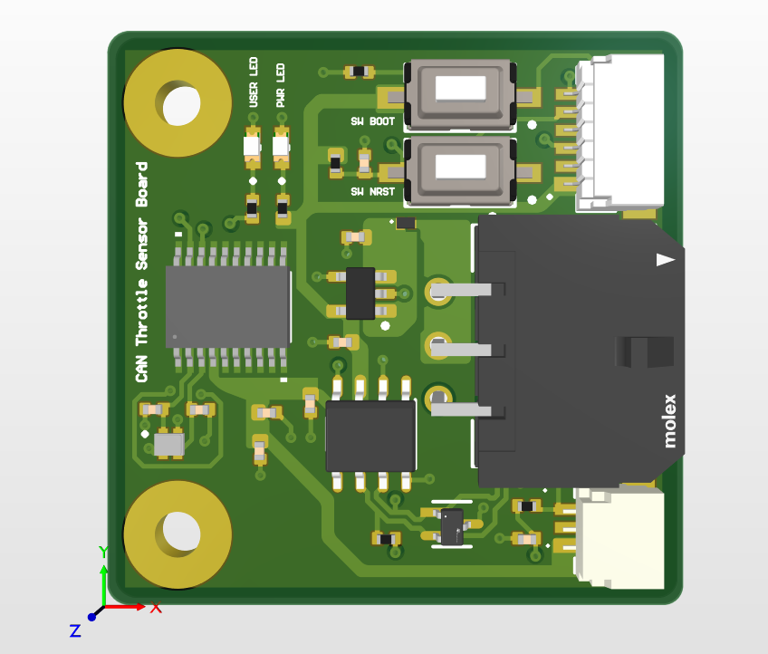
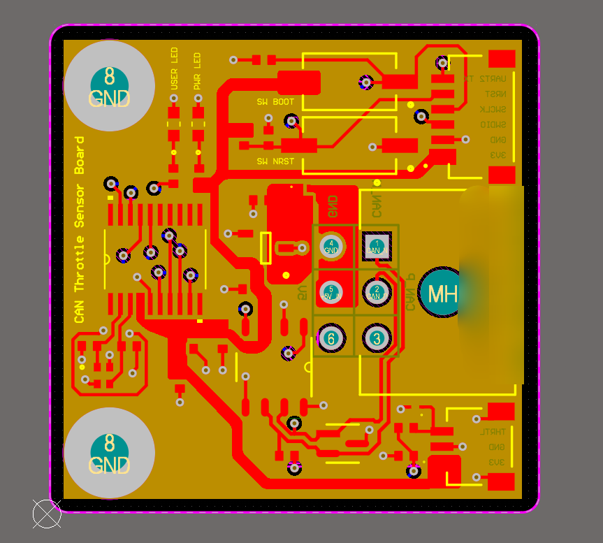

# CAN Throttle Sensor Board

A small board that reads a throttle sensor and sends the reading over CAN, designed in Altium Designer for a student team's vehicle.

> **Work in progress:** the board is designed; bring-up, firmware and testing come next.
>
> **Why there are no design files here:** the board belongs to the team, so the schematic, layout files and gerbers stay private. This repo describes the design.

## At a glance

| | |
|---|---|
| MCU | STM32C092 (Arm Cortex-M0+ with a built-in FDCAN controller), 48 MHz crystal |
| CAN | TI TCAN330 3.3 V transceiver, 120 Ω termination, TVS protection |
| Power | 5 V in on the main connector, ST LDLN025 3.3 V LDO |
| Connectors | Molex Micro-Fit 3.0 (6-pin) for CAN and power, 3-pin 1 mm header for the throttle sensor, 6-pin 1 mm debug header |
| Extras | BOOT and reset buttons, power and user LEDs |
| Tools | Altium Designer |

## How it works

The throttle sensor plugs into the 3-pin header (signal, GND and 3.3 V) and is powered from the board.
The STM32 reads the throttle signal and sends it on the CAN bus through the TCAN330, so the rest of the vehicle gets throttle position on the same two wires as every other node.
The STM32C092 has its own CAN controller, so the only CAN part outside the MCU is the transceiver.

## Layout

The debug header brings out SWD (SWCLK, SWDIO, NRST) and a UART TX line, so the board can be flashed and debugged with a standard probe.
The BOOT and reset buttons sit next to it for recovering a board with bad firmware.
